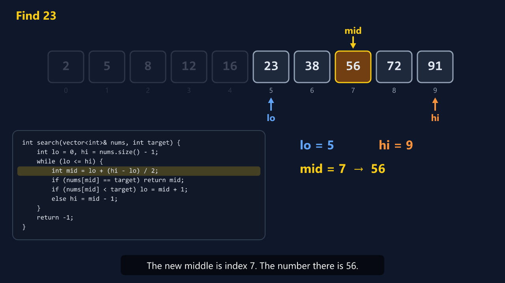

# vector-video

**Turn a scene script into a narrated `.mp4`.** Every frame is vector graphics drawn by code (shapes, arrows, text, code panels), and the voiceover is generated offline with [Kokoro](https://huggingface.co/hexgrad/Kokoro-82M), a natural-sounding neural voice, or your computer's built-in text-to-speech. No images, no stock footage, no cloud services.



Good for algorithm walkthroughs, bug explainers, architecture diagrams that build up step by step, and short product intros.

## How it works

1. You write a **scene file** (JSON or a JS module): a list of scenes, each with narration lines and elements.
2. The renderer speaks the narration and measures each line, so **scene length follows the speech**. You never guess durations.
3. Animations are pinned to words with cues: `appear: "@swap+0.5"` shows an element half a second after the line tagged `swap` starts.
4. Every frame is drawn as SVG, rasterized with [resvg](https://github.com/RazrFalcon/resvg), and joined with the audio by ffmpeg.

```json
{
  "captions": true,
  "scenes": [{
    "narration": ["This box turns green.", { "say": "Then it moves.", "cue": "move" }],
    "elements": [
      { "type": "box", "text": "7", "x": 200, "y": 300, "w": 100, "h": 100,
        "appear": { "t": 0.3, "effect": "pop" },
        "keyframes": [
          { "t": "@0+1", "dur": 0.3, "fill": "#14532d", "stroke": "#22c55e" },
          { "t": "@move", "dur": 1, "dx": 600 }
        ] }
    ]
  }]
}
```

## Features

- **Narration-driven timing**: cues like `@name`, `@name.end`, `@name+1.2`, `@end-1` and `50%`.
- **Elements**: `rect`, `circle`, `line`, `arrow`, `path`, `polygon`, `text`, `box`, `code` panels with a moving highlight bar, `group`, and raw vector `svg`.
- **Effects**: fade, pop, slide up, typewriter text, self-drawing lines and paths, plus keyframes for position, color, scale, rotation and more.
- **Captions**: optional subtitles from the narration, with separate spoken and shown text (`say` / `caption`).
- **Fast iteration**: `--timeline` prints when every line is spoken, `--stills` saves PNG previews, and speech is cached so visual re-renders take seconds.
- **Natural offline voice**: [Kokoro](https://huggingface.co/hexgrad/Kokoro-82M) (Apache-2.0) runs on your CPU, with US and UK voices like `af_heart`, `am_michael` and `bf_emma`. The model downloads once (~92 MB).
- **Fallback voices**: Windows speech voices (no install), `say` on macOS, `espeak-ng` on Linux. Used automatically when Kokoro is unavailable, or with `--tts system`.

Full reference: [skills/vector-video/FORMAT.md](skills/vector-video/FORMAT.md).

## Install

### As a plugin
```
/plugin marketplace add gsush701-gif/vector-video
/plugin install vector-video@vector-video
```
Then ask for a video, for example "make a 45 second explainer of how binary search works". The skill instructions are in [skills/vector-video/SKILL.md](skills/vector-video/SKILL.md).

### Standalone CLI
```bash
git clone https://github.com/gsush701-gif/vector-video
cd vector-video/skills/vector-video
npm install                                          # resvg + ffmpeg + Kokoro voice
node scripts/render.js examples/hello.json hello.mp4
```

Requires Node 18+. The full install is about 830 MB because of Kokoro's ONNX runtime; skip it with `npm install --omit=optional` to use only the system voices.

## Command line

```
node scripts/render.js <scene.json|scene.js> [out.mp4] [options]
  --timeline         print when every scene and narration line starts, then stop
  --stills <list>    save PNG previews: "12.5" (seconds) or "2@3.5" (scene 2, 3.5 s in)
  --stills-dir <dir> where previews go (default <out>-stills)
  --video            with --stills, also render the video
  --no-audio         skip speech (lengths guessed from word count) for quick drafts
  --scale 0.5        render smaller, for fast drafts
  --tts <engine>     auto (default) | kokoro | system
```

## Examples

| File | What it shows |
|---|---|
| [`hello.json`](skills/vector-video/examples/hello.json) | The smallest possible scene: a title, a moving circle, an arrow |
| [`binary-search.js`](skills/vector-video/examples/binary-search.js) | An algorithm walkthrough with an array, pointers and a code panel |
| [`strstr.js`](skills/vector-video/examples/strstr.js) | A bug explainer: why a naive substring search fails, then the fix |

## Tips

- **Writing narration**: use short, simple sentences. Write numbers as digits, say "minus 1" instead of "-1", and describe code in words instead of reading symbols aloud. Speech engines read a lone "a" as "uh".
- **Lay out for captions**: the canvas is 1280 x 720. Keep 40 px margins and leave the bottom ~80 px free when captions are on.
- **`lineHeight` is a multiplier** of the font size (`1.5`), not pixels.
- **JS scene files**: use `module.exports = { ... }`. Inside a project whose `package.json` has `"type": "module"`, name the file `.cjs`.

## License

[MIT](LICENSE)
